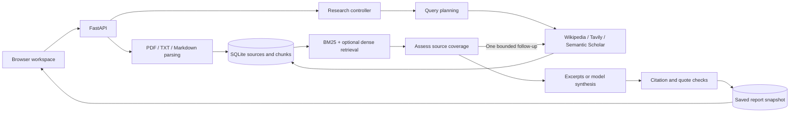

# Research Atlas — Agentic RAG Research Platform

<p align="center">
  
</p>

<p align="center">
  <a href="https://python.org"></a>
  <a href="https://fastapi.tiangolo.com"></a>
  <a href="https://sqlite.org"></a>
  <a href="https://www.tavily.com"></a>
  <a href="https://www.semanticscholar.org"></a>
  <a href="https://pypi.org/project/sentence-transformers/"></a>
  <a href="LICENSE"></a>
</p>

---

## 🎯 Overview

A **local research workspace** that combines uploaded documents and web evidence into cited reports. Ask a question, inspect the research trail, open each supporting excerpt, and export the report.

**Current status:** Working single-user application. Document research works without API keys. AI-written synthesis and broad web search require provider configuration. This is a tested foundation, not a claim of production readiness or perfect factual accuracy.

---

## 🚀 Run Locally

Python 3.11+ is required. The core application was verified on Windows with Python 3.14.

```powershell
# Create virtual environment
python -m venv .venv-platform
.venv-platform\Scripts\python.exe -m pip install -r requirements.txt
.venv-platform\Scripts\python.exe main.py
```

Open **http://127.0.0.1:8000**. The API reference is at **http://127.0.0.1:8000/docs**.

On macOS/Linux, use `.venv-platform/bin/python` in place of the Windows executable. To use a different local port, add `--port 8001`.

---

## 🔬 First Research Run

1. **Open Source Library** — Upload a PDF/TXT/Markdown file or choose **Paste text**
2. **At Research Desk** — Write a focused question
3. **Select Mode** — *My documents*, *Web only*, or *Web + library* (restrict document set, include Semantic Scholar abstracts)
4. **Start Research** — The agent plans queries, retrieves passages, assesses source coverage, and performs one additional web search if fewer than three sources were found
5. **Inspect Results** — **Findings**, **Sources & evidence**, and **Research trail**. Citation buttons jump to the corresponding excerpt
6. **Export** — Download Markdown or JSON. **Saved research** retains reports across restarts

> Without an AI key, findings are exact source excerpts labeled **Evidence report**. They are useful for collecting evidence but are not a synthesized answer.

---

## ⚙️ Configuration

See `.env.example`. Add the values you need to your existing `.env`; do not overwrite existing secrets. Restart the server after editing configuration. Keys remain on the server and are never returned by the status API.

| Variable | Purpose | Default |
|----------|---------|---------|
| `DATA_DIR` | SQLite library, chunks, and reports | `data/platform` |
| `LLM_BASE_URL` | OpenAI-compatible chat-completions API | `https://ai-gateway.vercel.sh/v1` |
| `LLM_API_KEY` | Model provider credential | Empty: synthesis disabled |
| `LLM_MODEL` | Model ID available to your account | Empty: synthesis disabled |
| `TAVILY_API_KEY` | General web discovery | Empty: Wikipedia introductions only |
| `SEMANTIC_SCHOLAR_API_KEY` | Authenticated scholarly search | Public requests if absent |
| `RETRIEVAL_MODE` | `lexical` or `hybrid` | `lexical` |
| `EMBEDDING_MODEL` | Sentence Transformer model for hybrid retrieval | `sentence-transformers/all-MiniLM-L6-v2` |

AI synthesis needs both `LLM_API_KEY` and `LLM_MODEL`. The endpoint must support `/chat/completions`, JSON object responses, and the configured model.

---

## 🏗️ Architecture



| Module | Responsibility |
|--------|----------------|
| `app/api.py` | Validated API routes, bounded background jobs, local request boundaries |
| `app/static/` | Responsive research desk, source library, report viewer, history |
| `src/ingestion/documents.py` | Parsing, normalization, page-preserving chunks, deduplication |
| `src/store.py` | SQLite transactions, FTS5/BM25 index, report persistence |
| `src/retrieval/local.py` | Lexical retrieval and optional dense/lexical rank fusion |
| `src/retrieval/web.py` | Fixed-endpoint web discovery and source normalization |
| `src/retrieval/semantic_scholar.py` | Scholar search with bounded rate-limit retries |
| `src/llm.py` | JSON query planning and grounded synthesis |
| `src/agent.py` | Research steps, coverage branch, provenance checks, report export |
| `tests/test_platform.py` | Offline regression and integration coverage |

---

## 🔍 Retrieval Details

Documents are split into **~1,200-character passages** with **180-character overlap**. PDF page boundaries are preserved. SQLite FTS5 uses Porter stemming and BM25 with higher title weight. Search punctuation is converted to quoted terms rather than interpolated into SQL.

The default is **lexical RAG**: retrieval based on text matches rather than embeddings. Optional hybrid retrieval uses local Sentence Transformer embeddings and reciprocal rank fusion.

```powershell
# Enable hybrid retrieval
.venv-platform\Scripts\python.exe -m pip install -r requirements-semantic.txt
```

Then set `RETRIEVAL_MODE=hybrid` and restart. The first query downloads the embedding model and can take longer.

---

## 📡 API Endpoints

| Method & Path | Action |
|---------------|--------|
| `GET /api/status` | Capabilities and connection status (without keys) |
| `GET /api/documents` | List uploaded and discovered sources |
| `POST /api/documents` | Multipart upload in the `file` field |
| `POST /api/documents/text` | Add `{title, text}` |
| `DELETE /api/documents/{id}` | Remove source and index entries; saved evidence stays |
| `POST /api/research` | Queue `{question, mode, source_ids?, include_papers?}` |
| `GET /api/research` | Latest 100 research runs |
| `GET /api/research/{id}` | Progress, evidence and completed findings |
| `GET /api/research/{id}/report` | Markdown download; use `?format=json` for JSON |

---

## ✅ Verification

```powershell
# Install dev dependencies
.venv-platform\Scripts\python.exe -m pip install -r requirements-dev.txt

# Run tests
.venv-platform\Scripts\python.exe -m pytest -q
.venv-platform\Scripts\python.exe -m ruff check app src tests scripts main.py
node --check app/static/app.js
.venv-platform\Scripts\python.exe scripts/check_web.py
```

The regression suite uses temporary databases and mocked providers; no model charges or external requests needed. `check_web.py` is an explicitly live, public Wikipedia check.

---

## 🛡️ Boundaries

- **Local single-user app**: No login, tenant isolation, public deployment, or team sharing yet
- **Concurrency**: Up to two running and two queued research jobs
- **Upload limits**: 10 MB, 200,000 extracted characters, 300 PDF pages
- **Web evidence**: Provider excerpts only (Wikipedia intros, scholarly abstracts)
- **Citation checks**: Verify IDs and verbatim quote presence — they don't prove logical entailment
- **Public deployment** requires: authentication, isolated storage, durable job infrastructure, operational monitoring, and independent security/retrieval evaluation

---

## 📄 License

This project is licensed under the **MIT License** — see [LICENSE](LICENSE) for details.

---

<p align="center">
  
</p>